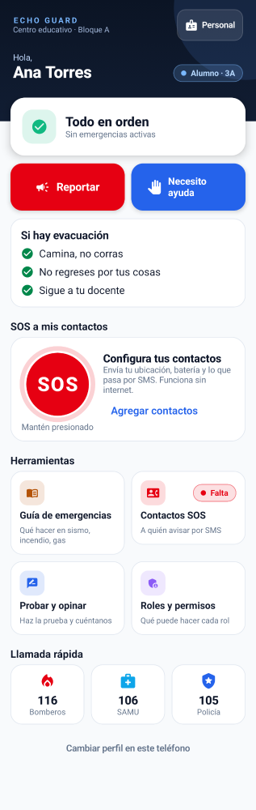
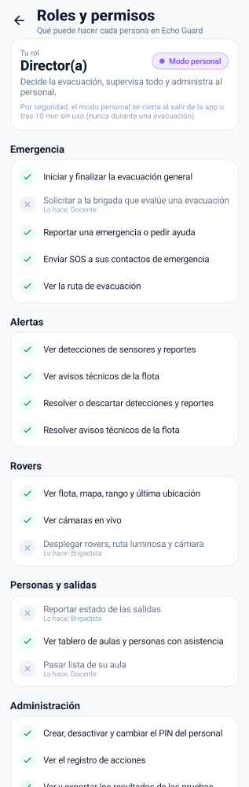
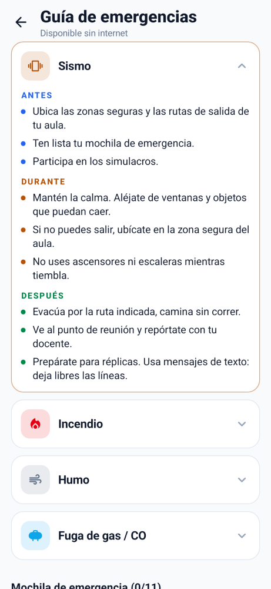

# Echo Guard · App de evacuación segura (Kotlin + Jetpack Compose + Material 3)

App de la brigada y la comunidad educativa para el sistema **Echo Guard** (rovers con sensores +
estaciones de pared). Grupo 3 · Tecsup.

> **Echo Guard** = *Echo* (el eco que guía la evacuación) + *Guard* (resguardo, seguridad).

| Inicio (alumno) | Roles y permisos (dirección) | Guía sin internet |
|:-:|:-:|:-:|
|  |  |  |

## Cómo abrir
1. Android Studio (Ladybug o superior) → **Open** → la carpeta del repositorio.
2. Esperar la sincronización de Gradle → **Run** en emulador o celular (Android 8.0+).
3. **Primera vez:** registro único (nombre + "Alumno" con su aula, o "Visitante"). Sin contraseña.
   El perfil queda guardado en el teléfono: al volver a abrir la app entra directo a Inicio.
4. **Personal:** botón "Personal" en Inicio (o "Soy docente o brigadista" en el registro) → PIN.

También puedes descargar el APK listo para instalar desde la pestaña **Actions** de GitHub
(artefacto `echo-guard-debug-apk`).

| Modo | Cómo se entra | ¿Se mantiene al cerrar la app? |
|---|---|---|
| Alumno / Visitante | Registro único | ✅ Sí, siempre |
| Docente (aula 3B) | PIN 3333 (demo) | ❌ Al reabrir vuelve al perfil regular |
| Brigadista | PIN 1111 (demo) | ❌ |
| Dirección | PIN 2222 (demo) | ❌ |

## Roles y permisos
Todo se decide en **una sola matriz** (`Permission` × `Role` en `data/model/Models.kt`). Las pantallas
la usan para mostrar u ocultar acciones, y **el repositorio la vuelve a validar** en cada acción
sensible: aunque una pantalla mostrara un botón por error, la acción no se ejecutaría.

| Acción | Brigadista | Director | Docente | Alumno / Visitante |
|---|:-:|:-:|:-:|:-:|
| Iniciar / finalizar evacuación general | ✅ | ✅ | ❌ (solicita) | ❌ (reporta) |
| Controlar rovers (desplegar, luz, cámara) | ✅ | 👁 solo lectura | ❌ | ❌ |
| Ver flota, mapa, rango y última ubicación | ✅ | ✅ | ❌ | ❌ |
| Cámaras en vivo | ✅ | ✅ | ❌ | ❌ |
| Ver y resolver detecciones y reportes | ✅ | ✅ | ❌ | ❌ |
| Reportar estado de salidas | ✅ | ❌ | ❌ | ❌ |
| Pasar lista de su aula | — | — | ✅ | ❌ |
| Tablero de aulas, asistencia y "a salvo" | ✅ | ✅ | ❌ | ❌ |
| Crear / desactivar personal y cambiar PIN | ❌ | ✅ | ❌ | ❌ |
| Ver registro de acciones (auditoría) | ❌ | ✅ | ❌ | ❌ |
| Ver resultados de las pruebas y reiniciar la demo | ✅ | ✅ | ❌ | ❌ |
| Ver ruta, guía de emergencias, "Estoy a salvo" | ✅ | ✅ | ✅ | ✅ |
| Reportar emergencia / pedir ayuda / SOS a contactos | ✅ | ✅ | ✅ | ✅ (reportar también sin registrarse) |

La matriz completa también se ve en la app: **Inicio → Roles y permisos**.

**Seguridad del modo personal**
- Los PIN se guardan **solo como hash SHA-256** en la base de datos, nunca en texto plano.
- **5 intentos fallidos → bloqueo de 30 s.**
- El modo personal **no se guarda** al cerrar la app y **se cierra solo tras 10 min sin uso**,
  excepto durante una evacuación (para no dejar a la brigada fuera en plena emergencia).
- Dirección administra las cuentas: crear personas (con aula para docentes), desactivarlas y
  cambiar PIN. No puede desactivarse a sí misma ni dejar el colegio sin una cuenta de dirección.
- Cada acción sensible (iniciar o finalizar una evacuación, desplegar rovers, resolver alertas,
  pasar lista, enviar SOS, cambios de personal...) queda en el **registro de acciones**.

Las detecciones de sensores y los reportes solo llegan a quien decide (brigada y dirección), para
evitar pánico por falsas alarmas. La evacuación, en cambio, llega a todos.

## SOS a contactos de emergencia (funciona sin internet)
**Inicio → mantener presionado SOS** (1,5 s, para evitar envíos accidentales) → elegir qué pasa
(*Estoy a salvo · Necesito ayuda · Estoy herido(a) · Estoy atrapado(a)*) → **Enviar**.

El mensaje se envía por **SMS**: no necesita datos ni wifi, solo señal del operador. Incluye:
- Nombre, rol y aula.
- **Ubicación GPS** con enlace a Google Maps, precisión y antigüedad. El GPS funciona sin internet.
- **Batería** (% y si está cargando, en ahorro o por agotarse).
- Si hay una **evacuación en curso**, su causa y la **ruta recomendada**.
- Fecha y hora.

El texto va sin tildes para que entre en menos SMS y se lea en cualquier teléfono. Si la app no tiene
permiso de SMS (o el teléfono no tiene SIM), abre la app de mensajes con todo ya escrito. Puedes
guardar hasta 5 contactos (a mano o elegidos de la agenda, sin dar permiso a todos tus contactos)
y queda un historial de los últimos SOS.

## Probar la app con usuarios (opiniones)
**Inicio → Probar y opinar.** Es una prueba guiada de unos 5 minutos:
1. **Tareas según el rol** (por ejemplo: encontrar la ruta, enviar un SOS, iniciar un simulacro, pasar
   lista). La persona marca *Fácil / Me costó / No pude / No la probé*.
2. **4 preguntas de 1 a 5** (facilidad, claridad, confianza en una emergencia real, diseño) y
   **recomendación de 0 a 10** (NPS).
3. **Comentarios**: qué le gustó, qué mejoraría, qué falló.

Las respuestas se guardan en la **base de datos del teléfono** (Room/SQLite) y funcionan sin internet.
- **Exportar CSV** (se abre en Excel o Google Sheets) y compartir por WhatsApp, correo o Drive.
- Brigada y dirección ven los **resultados**: promedios, NPS, % de éxito por tarea (las más
  difíciles primero) y los comentarios recientes.
- **Siguiente participante**: reinicia la demo y borra el perfil para que la siguiente persona se
  registre (las respuestas se conservan). Ideal para pruebas con un mismo teléfono.
- **Opcional, envío automático a Google Sheets**: sigue `docs/feedback-apps-script.gs` y agrega
  `feedbackUrl=https://script.google.com/macros/s/XXXX/exec` a `local.properties`. Si no hay
  internet, la app guarda la respuesta y la envía después.

## Interfaz inspirada en apps reales de emergencia
- **Estado claro en Inicio**: "Todo en orden" o la señal de evacuación con la ruta, en grande.
- **"Estoy a salvo"** durante una evacuación (como el *Safety Check*): un toque. La brigada ve
  cuántas personas y quiénes se marcaron a salvo.
- **SOS de mantener presionado** con anillo de progreso (como *Personal Safety* o *AlertCops*).
  Con TalkBack basta un doble toque.
- **Guía de emergencias sin internet** (sismo, incendio, humo, gas: antes, durante y después) y
  **mochila de emergencia** de INDECI con checklist.
- Botones de al menos 48–60 dp, alto contraste, tema rojo inconfundible en una emergencia real,
  vibración en las acciones críticas y llamada rápida al 116 / 106 / 105.

## Arquitectura (MVVM)
```
com.floresvalencia.echoguard
├── AppGraph            Dependencias (inyección manual): base de datos y repositorios
├── data/model          Roles, Permission (matriz única), Rover, Alert, Classroom, SafeMark...
├── data/repository     EchoRepository (estado en vivo, simulación y validación de permisos)
│                       StaffRepository (cuentas de personal + auditoría en Room)
├── data/db             Room: personal, auditoría, opiniones, contactos y SOS
├── data/feedback       Tareas por rol, estadísticas, CSV/JSON y envío opcional
├── data/sos            Mensaje SOS, SMS sin internet, GPS y batería
├── notification        AlarmNotifier: notificación de alarma a pantalla completa
├── ui/components       Cabeceras, botones grandes, SOS de mantener presionado, plano del edificio
├── ui/navigation       Pestañas por rol, NavHost, AppViewModel (sesión, alarmas, avisos)
└── ui/screens          access · home · monitor · fleet · evacuation · classroom · route · alerts
                        permissions · feedback · sos · guide
```

## Probar el flujo completo
1. Regístrate como **alumno** → **Contactos SOS** → agrega un número → **mantén presionado SOS**.
2. "Reportar" → Fuego. (No puede evacuar: solo avisa.)
3. "Personal" → PIN 1111 (**brigadista**) → aparece la alarma → "Iniciar evacuación" → Simulacro.
4. "Salir" → vuelves a tu perfil de alumno → **"Estoy a salvo"**.
5. "Personal" → PIN 2222 (**dirección**) → Evacuación → Aulas: ves quién está a salvo.
   **Roles y permisos** → crea un docente nuevo y revisa el **registro de acciones**.
6. "Personal" → PIN 3333 (**docente**) → pasa lista en "Mi aula".
7. **Probar y opinar** → completa la prueba → "Siguiente participante".

## Desarrollo
```bash
./gradlew testDebugUnitTest   # pruebas unitarias (permisos, sesión, SOS, estadísticas)
./gradlew lintDebug           # lint de Android
./gradlew assembleDebug       # APK en app/build/outputs/apk/debug/
```
GitHub Actions corre las tres en cada push (`.github/workflows/android.yml`) y publica el APK.

El esquema de la base de datos se versiona en `app/schemas/`. Si cambias una entidad, sube la
`version` de `EchoDatabase` y agrega una migración.

## Conectar el hardware real
Reemplazar el cuerpo de las funciones de `EchoRepository` (MQTT, Firebase o HTTP al ESP32).
Los umbrales de sensores están en `SensorReadings` y deben calibrarse con los sensores reales.
Para producción, los PIN del personal deberían validarse en un servidor, y las alarmas con la app
cerrada necesitan notificaciones push (FCM) o un servicio en primer plano.
